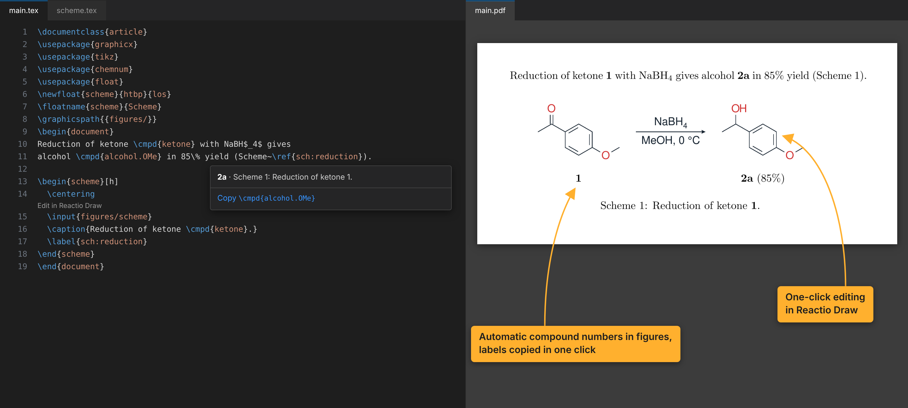

# Reactio Draw figures for LaTeX

Use [Reactio Draw](https://github.com/Paivel/reactio-draw) figures in LaTeX documents in VS Code (and in editors built on it,
such as Cursor and VSCodium). Works beside [LaTeX Workshop](https://marketplace.visualstudio.com/items?itemName=James-Yu.latex-workshop),
which builds the document and shows the PDF.

## Paste a figure with its files

In Reactio Draw, use **Copy for LaTeX**. In a `.tex` file, paste (Cmd+V / Ctrl+V):

- the drawing and the files made from it (`scheme.reactio`, `scheme.pdf`, `scheme.tex`) are copied into `figures/`, beside
  the main document, never over an existing file: a name that is taken moves the set to `scheme-2.*`;
- `\input{figures/scheme}` goes in. On an empty line of the text, outside any figure, it comes inside a whole `figure`
  with an empty `\caption{}` and `\label{fig:}`, filled in with Tab. In a document with a scheme float (the ACS class
  `achemso`, `chemstyle`, or `\newfloat{scheme}`) it is a `scheme` with `\label{sch:}`; `reactioLatex.paste.float` picks one always;
- the main document's preamble gets what it lacks: `graphicx`, `tikz`, `chemnum`, `\graphicspath{{figures/}}` and the
  `\rcmpd` definition for compound marks. Lines that are more than plain definitions are shown first.

The main document is the file with `\begin{document}`, the one named by a `% !TeX root = main.tex` line, or the document
that includes the file you paste into. Without one, a notice names the lines to add.

If a plain paste brings only the `\input` line, use **Paste Figure with Its Files** in the editor's context menu (or the
Command Palette): it reads the figure from the system clipboard itself.

## Edit the figure

Above each line that includes a figure made from a drawing, **Edit in Reactio Draw** opens the drawing in Reactio Draw. Save
it there: Reactio Draw writes `scheme.pdf` and `scheme.tex` again, and LaTeX Workshop rebuilds the document on its own
(its `latex-workshop.latex.autoBuild.run` setting, `onFileChange` by default).

The drawing also opens from the explorer: **Edit Figure Source** in the context menu of a figure's `.tex` or `.pdf`, and
a `.reactio` file opened in VS Code shows an **Open in Reactio Draw** button. In the PDF, Ctrl+click (Cmd+click on a Mac)
jumps to the line that includes the figure, where the button is.

Only drawing formats open in another program (`.reactio`, `.cdxml`, `.cdx`, `.drawio`, `.dio`, `.ipe`, `.excalidraw`,
`.ggb`, `.odg`), and only from inside the workspace, in a trusted workspace. An `.svg` asks each time, since its program is
often a browser; any other file is only shown in the file manager.

## Compound numbers

A mark `[[ketone]]` in a drawing becomes `\rcmpd{ketone}` in its `.tex`; write the same in the text. LaTeX numbers the
compounds with `chemnum`, so the drawing and the text always agree. After a build:

- resting the pointer on `\rcmpd{…}` or `\cmpd{…}` shows the compound's number and the figure it is drawn in, with a link to
  copy the command;
- typing `\rcmpd{` or `\cmpd{` lists the project's compounds with their numbers and figures.
- a number seen in the PDF finds its compound: **Copy Compound by Number** in the Command Palette takes the number and copies
  the exact LaTeX that cites it (`\rcmpd{amine.a.num}`), and the **Compounds** view in the explorer lists every compound by
  number, with that LaTeX and the figure it is drawn in; a click copies it. (The PDF viewer is LaTeX Workshop's, which other
  extensions cannot add hovers to.)

The numbers are read from the build's `.aux` file, beside the main document or in LaTeX Workshop's `outDir`; another
folder can be set in `reactioLatex.auxDirectory`.

Every kind of mark: [LaTeX marks](https://github.com/Paivel/reactio-draw/blob/main/docs/latex-marks.md).

## Figures for a journal

**Export Figures for Submission** (the editor's context menu, or the Command Palette) writes each figure made from a
drawing, cut out of the built document with its compound numbers, into `figures-for-submission/`, named by its
function: `Scheme1.pdf` and `Scheme1.tiff`, `Figure2.pdf`… A second figure in one float is `Scheme1b`. Journals such as
ACS take figures as separate TIFF, PDF or EPS files at 300 dpi for colour, 600 dpi for grayscale and 1200 dpi for line
art; set the TIFF's resolution in `reactioLatex.export.tiffDpi`. The figure files in the drawing's own `scheme.pdf` carry
no numbers (LaTeX sets them over it), so send these instead.

Beside the figures it writes the article itself as one `.tex` (`main.tex`), for a journal that builds the LaTeX: the
project's `\input` and `\include` files are written into it, and each figure from a drawing becomes
`\includegraphics{Scheme1}`, the exported file. The figure's marks stay in an unprinted box after it, so every
compound keeps its number in the text. The images, `.bib` and `.bbl` files and any class or style files beside the
article are copied too, and the copy is built from that folder to check that nothing is missing; its PDF (`main.pdf`) is put beside it. Your own files
do not change. Turn it off with `reactioLatex.export.texCopy`.

The document is built once more for this, in a scratch folder, with the engine named in a `% !TeX program` line or
pdflatex; the working files are not changed. TIFF is drawn by macOS itself, or by Ghostscript or pdftoppm elsewhere.

## The clipboard format

Reactio Draw puts an editable-figure manifest on the clipboard, an open format any drawing program can write; it is
described in Lattice's [`docs/editable-figures.md`](https://github.com/leo1oel/lattice/blob/main/docs/editable-figures.md).
A paste can come from any program, so the manifest never names a path on disk, carries at most 32 files and 64 MB, and
only figure file types come in.

## Settings

| Setting | Default | |
| --- | --- | --- |
| `reactioLatex.figuresFolder` | `figures` | Folder, beside the main document, that pasted figures go into. |
| `reactioLatex.codeLens` | `true` | Show Edit in Reactio Draw above figure lines. |
| `reactioLatex.auxDirectory` | | The build's `.aux` folder, if not found on its own. |
| `reactioLatex.export.folder` | `figures-for-submission` | Where exported figures go. |
| `reactioLatex.export.tiff` | `true` | Also write TIFF files. |
| `reactioLatex.export.tiffDpi` | `600` | 300, 600 or 1200. |
| `reactioLatex.export.texCopy` | `true` | Also write the article as one `.tex` that includes the exported figures. |
| `reactioLatex.export.engine` | `auto` | pdflatex, xelatex or lualatex for the export build. |

## License

Apache-2.0. Parts are adapted from [Lattice](https://github.com/leo1oel/lattice) (Apache-2.0); it bundles pdf-lib (MIT). See NOTICE.
